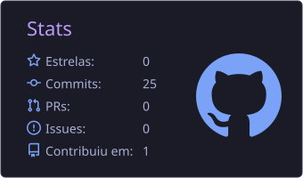
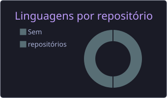
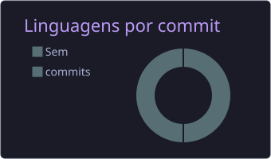

<h2 data-importer="text" align="center">👨🏻‍💻 SOBRE MIM</h2>

<a>

👋🏻 Olá! Me chamo Nexus Dev.
  
💻 Sou um Desenvolvedor Júnior apaixonado por tecnologia e em constante evolução.

🌐 Estou focado em consolidar meus conhecimentos em desenvolvimento Front-End e Mobile, construindo projetos práticos e aplicando boas práticas de código.

🌱 Atualmente aprendendo: Arquitetura de software e ecossistemas avançados de TypeScript e Kotlin.

🎯 Meu objetivo: Evoluir tecnicamente, colaborar em projetos desafiadores e crescer na carreira de desenvolvimento.

▶️  Compartilho minha jornada na programação no meu canal do YouTube!
</a>

<h2 data-importer="text" align="center"></h2>

<h2 data-importer="text" align="center">🤖 FERRAMENTAS E LINGUAGENS</h2>

<h2 data-importer="text" align="center">📊 ESTATÍSTICAS</h2>

